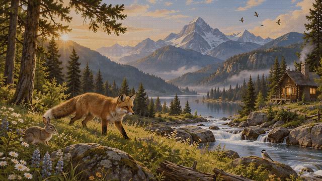

# Pixel Frame

Painted, animated landscapes for a Raspberry Pi picture frame. Ten 1920×1080
scenes play as seamless 24-second loops on the Linux framebuffer. There is no
desktop, touchscreen or network service involved.



## Start it at boot

Run this once:

```bash
sudo ./install-service.sh
```

This installs `pixel-frame.service`, which shows the frame on the display's
first console (tty1) at every boot and restarts it if it crashes. It runs as
your account, not as root.

The service owns only tty1. SSH sessions are not involved: they get a normal
shell, with no login hook and no flag to remember. On a keyboard attached to
the display (or through a KVM), press Ctrl+Alt+F2 for a login prompt and
Ctrl+Alt+F1 to return to the frame. While another console is shown, the frame
pauses instead of drawing over it.

Control it without sudo, from anywhere:

```bash
pixel-frame status     # running? which scene?
pixel-frame logs       # recent scene changes and errors
pixel-frame stop       # tty1 gets its login prompt back
pixel-frame start
pixel-frame restart    # after editing the code
pixel-frame run --start-scene pond   # foreground run, Ctrl-C to quit
```

Only one copy can draw at a time. A second copy, for example `pixel-frame run`
while the service is running, exits with a message instead of fighting over
the screen.

To change options for the service, put them in `/etc/default/pixel-frame` and
restart:

```bash
PIXEL_FRAME_ARGS="--quiet-hours 00:00-06:30 --seconds-per-scene 600"
```

## What you see

**The real sky.** Lighting follows the sun where you live: dawn colours at
sunrise, full light at noon, an amber dusk at sunset and moonlit blue at night.
The location defaults to your time zone's city (from tzdata); set
`--latitude` and `--longitude` to be exact. `--day-seconds 120` runs a fast
two-minute day instead, for demos.

**Lights at night.** Cabin windows, lanterns, the village and the tree lights
keep glowing warm after dark while the rest of the painting dims.

**Quiet hours.** The picture dims during the hour before 23:00 and the display
switches off from 23:00 to 07:00. Change it with `--quiet-hours 22:30-06:00`,
or turn it off with `--quiet-hours off`.

**Seasons.** Each scene shows for 12 minutes, then crossfades to the next.
Seasonal scenes join the playlist in their months; the rest play all year.

| Scene | Months | Motion |
| --- | --- | --- |
| Woodland | all year | River glints, swaying plants, the fox and rabbit |
| Meadow | all year | Butterflies, flowers, the windmill turning |
| Pond | all year | Ducks gliding, surface glints, reeds |
| Autumn | Sep–Nov | Drifting maple leaves, the fox |
| Winter | Dec–Feb | Falling snow, the lit cabin, the snowman and fox |
| Christmas | Dec | Snow, twinkling tree lights, the nativity |
| Tornado | all year | The funnel, the airborne car and cow |
| Tsunami | all year | Foam, the bobbing boat, the helicopter |
| Balloons | all year | Balloons drifting over flowers |
| Sakura | Mar–May | Falling petals, the stream under the bridge |

Scene slots follow the clock, so after a restart the frame shows the scene that
was due rather than starting over. `--start-scene NAME` shows one scene first,
whatever the season, and then rejoins the playlist. `--seconds-per-scene 20`
gives a quick tour.

## Your own scenes

Put stills or animations in `scenes/`: PNG, JPG, animated GIF or WebP. Each
file joins the playlist all year under its file name, with the same day and
night lighting. Pictures are scaled to fill the screen. Small pixel art keeps
its hard edges.

To make windows or lamps glow at night, add a mask with the same name and a
`-glow.png` suffix, white where the light is: `scenes/harbour.png` and
`scenes/harbour-glow.png`.

## Share a scene

GIFs play everywhere, so the frame exports them, lit for any time of day:

```bash
python3 pixel_frame.py --scene christmas --at 21:00 --export-gif christmas.gif
python3 pixel_frame.py --scene pond --at 07:30 --export pond.png
```

GIFs are 640 pixels wide by default (`--gif-width`). Every frame shares one
palette and only stores the pixels that changed, which keeps a 24-second loop
small enough to send in a chat. `assets/woodland-animated.gif` above is made
this way.

## How the loops are made

Each scene starts as one painted keyframe. `upscale_keyframes.py` enlarges the
836×470 painting to 1920×1080 with Real-ESRGAN, so the loops are sharp rather
than stretched. `build_animated_asset.py` then animates the keyframe:
`scene_motion.py` marks water, foliage, smoke and weather regions for periodic
motion with a fixed camera, and lifts ducks, balloons, butterflies, the boat
and the helicopter onto their own moving layers. The windmill sails and the
rotor turn independently. Motion keeps a six-second beat; a gust that rises and
falls once per loop, and particles that take a new path on every fall, keep
the 24 seconds from repeating.

The build needs OpenCV and PyTorch, the player needs neither:

```bash
python3 -m venv --system-site-packages .venv-animation
.venv-animation/bin/pip install opencv-python-headless
.venv-animation/bin/pip install --index-url https://download.pytorch.org/whl/cpu torch
mkdir -p ~/.cache/pixel-frame/models && cd ~/.cache/pixel-frame/models
curl -LO https://github.com/xinntao/Real-ESRGAN/releases/download/v0.1.0/RealESRGAN_x4plus.pth
cd -
.venv-animation/bin/python upscale_keyframes.py woodland   # 15–30 minutes on a Pi 4
.venv-animation/bin/python build_animated_asset.py woodland
python3 audit_animations.py
```

`audit_animations.py` checks frame counts, timing, visible motion and the
last-to-first transition, and refreshes the posters for
`previews/animations.html`, a browser gallery of the loops.

## Under the hood

The player decodes the current and the next scene in the background and keeps
their frames in the display's RGB565 format. Lighting a frame is then one
table lookup per pixel, about 25 ms on a Pi 4 at 8 FPS. It needs an RGB565
(16-bit) Linux framebuffer and reads its resolution, offsets and stride.

```bash
python3 -m unittest -v                                        # player
.venv-animation/bin/python -m unittest test_animation_encoder # build
```

`python3 pixel_frame.py --tty` shows an ASCII woodland in a text terminal
instead: Q or Esc quits, Space pauses and N skips ahead a quarter of a day.
